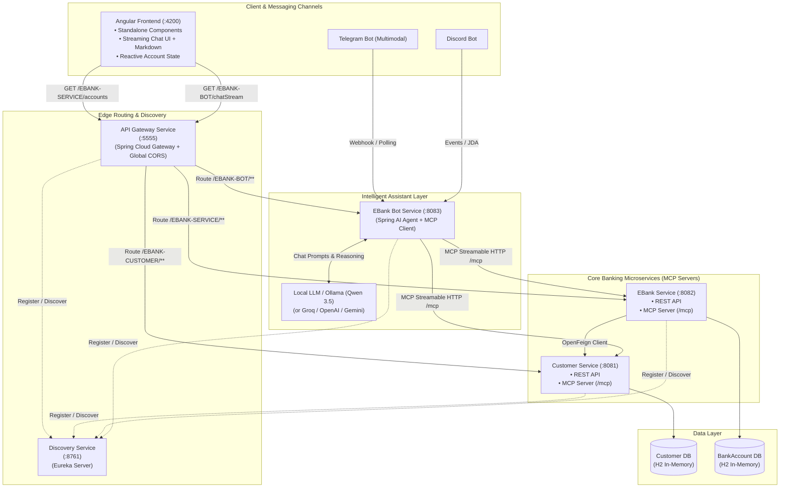

# 🏦 FlowBank-Nexus

[](https://openjdk.org/)
[](https://spring.io/projects/spring-boot)
[](https://spring.io/projects/spring-cloud)
[](https://spring.io/projects/spring-ai)
[](https://modelcontextprotocol.io/)
[](https://angular.dev/)
[-black.svg?logo=ollama)](https://ollama.com/)
[](https://core.telegram.org/bots)
[](https://discord.com/developers/docs)
[](LICENSE)

**FlowBank-Nexus** is a next-generation distributed e-banking platform powered by **Spring Cloud**, **Spring AI**, **Angular**, and Anthropic's **Model Context Protocol (MCP)**. It integrates an intelligent multi-agent banking assistant that autonomously queries and interacts with distributed microservices over MCP Streamable HTTP, accessible across a modern **Angular Web Portal**, **Telegram**, **Discord**, and **Reactive Streaming REST APIs**.

---

## 📑 Table of Contents

- [Architectural Overview](#-architectural-overview)
- [System Architecture Diagram](#-system-architecture-diagram)
- [Ecosystem & Services Catalog](#-ecosystem--services-catalog)
- [Angular Web Application](#-angular-web-application)
- [Model Context Protocol (MCP) & AI Integration](#-model-context-protocol-mcp--ai-integration)
- [Multi-Channel Bot Interfaces](#-multi-channel-bot-interfaces)
- [Technology Stack](#-technology-stack)
- [Prerequisites & Requirements](#-prerequisites--requirements)
- [Getting Started & Startup Sequence](#-getting-started--startup-sequence)
- [Endpoints & Dashboards](#-endpoints--dashboards)
- [Configuration Reference](#-configuration-reference)

---

## 🏛 Architectural Overview

FlowBank-Nexus decouples core banking domains into resilient microservices while empowering LLMs with runtime tool-execution capabilities using the **Model Context Protocol (MCP)**:

- **Decentralized Services**: Domain services (`customer-service`, `ebank-service`) serve both traditional REST clients and AI agents via MCP.
- **MCP Client/Server Topology**: Domain services act as **MCP Servers** exposing discrete operations as callable tools. The `ebank-bot` acts as an **MCP Client**, dynamically orchestrating tool invocations based on natural language queries.
- **Angular Single Page Application**: Standalone modern UI offering real-time bank account inspection and an interactive conversational AI interface with live Markdown rendering and progressive text streaming.
- **Reactive Streaming & Memory**: `ebank-bot` exposes reactive stream endpoints (`Flux<String>`) with session-scoped `ChatMemory` for context retention.
- **Multimodal & Multi-Platform**: The conversational agent answers banking queries, handles context memory, and accepts text and image inputs via Telegram and Discord bots.
- **Resilient Microservices Infrastructure**: Service registration and discovery handled via **Netflix Eureka**, with dynamic routing and global CORS support handled via **Spring Cloud Gateway**.

---

## 📐 System Architecture Diagram



---

## 🧩 Ecosystem & Services Catalog

| Component | Port | Technology | Description | Key Features |
| :--- | :---: | :--- | :--- | :--- |
| **`angular-front`** | `4200` | Angular 22, TypeScript, Bootstrap 5 | Modern Web Portal | Accounts table, live AI chat streaming, Markdown rendering, HTTP loading interceptor. |
| **`discovery-service`** | `8761` | Eureka Server | Discovery & Registry | Centralized service registry, heartbeat monitoring, instance discovery. |
| **`gateway-service`** | `5555` | Spring Cloud Gateway | Reactive API Gateway | Dynamic service routing (`DiscoveryClientRouteDefinitionLocator`), Global CORS filter. |
| **`customer-service`** | `8081` | Spring Boot, JPA, H2 | Customer Management & MCP Server | CRUD operations for customers, H2 persistence, MCP Streamable HTTP server (`/mcp`). |
| **`ebank-service`** | `8082` | Spring Boot, OpenFeign, H2 | Bank Account Management & MCP Server | Current & Savings account management, OpenFeign customer enrichment, MCP server (`/mcp`). |
| **`ebank-bot`** | `8083` | Spring AI, MCP Client | AI Banking Assistant & Multi-Channel Bot | Spring AI orchestration, MCP Client, session ChatMemory, reactive `/chatStream`, Telegram & Discord bots. |

---

## 💻 Angular Web Application

The `angular-front` application is built with Angular standalone components and reactive architecture:

- **Bank Accounts View (`/accounts`)**:
  - Fetches account data dynamically through the Gateway (`http://localhost:5555/EBANK-SERVICE/accounts`).
  - Implements an immutable reactive state pattern (`AccountListState` with `RequestStatus.SUCCESS` / `RequestStatus.ERROR`).
  - Utilizes Angular's `@for` control flow and `AsyncPipe` for declarative, leak-free subscriptions.

- **AI Chatbot Interface (`/bot`)**:
  - Interacts with `http://localhost:5555/EBANK-BOT/chatStream?query=...`.
  - **Progressive Streaming**: Listens to `HttpEventType.DownloadProgress` via `HttpClient` (`observe: 'events'`, `reportDownloadProgress: true`) to stream LLM tokens in real-time as they are produced.
  - **Rich Markdown Rendering**: Renders structured LLM output (tables, lists, bold text, code blocks) using `ngx-markdown`.

- **Global Loading Interceptor (`loadingInterceptorInterceptor`)**:
  - Automatically intercepts outgoing HTTP requests and signals `LoadingService`.
  - Displays dynamic bootstrap spinner indicators during active queries and API calls.

---

## 🤖 Model Context Protocol (MCP) & AI Integration

FlowBank-Nexus leverages **Spring AI** and the **Model Context Protocol (MCP)** specification over **Streamable HTTP**. Rather than hardcoding API connectors, domain services expose capabilities as self-describing tools to LLMs.

### Exposed MCP Tools Catalog

#### 1. `customer-service` (`http://localhost:8081/mcp`)
- `@McpTool getAllCustomers()`: Fetches all customer profiles.
- `@McpTool getCustomerById(Long id)`: Retrieves customer details by ID.
- `@McpTool saveCustomer(Customer customer)`: Registers and stores a new customer profile.

#### 2. `ebank-service` (`http://localhost:8082/mcp`)
- `@McpTool getAllBankAccounts()`: Fetches all bank accounts across the platform.
- `@McpTool getAccountById(String id)`: Retrieves bank account details and hydrates customer info via OpenFeign.
- `@McpTool save(BankAccount bankAccount)`: Generates an account UUID, timestamps creation, and persists account details.

### How the MCP Client Agent Operates
1. `ebank-bot` initializes with `spring-ai-starter-mcp-client`.
2. Connections are registered in `application.properties`:
   ```properties
   spring.ai.mcp.client.streamable-http.connections.customer.url=http://localhost:8081/mcp
   spring.ai.mcp.client.streamable-http.connections.ebank.url=http://localhost:8082/mcp
   ```
3. When a user asks: *"What is the balance of customer Achraf's accounts?"*, `EbankAIAgent` formulates a prompt, executes `getAllCustomers` or `getCustomerById`, then calls `getAllBankAccounts`, filters the data, and returns an accurate natural-language response.

### Reactive Streaming Support
In addition to synchronous chat, `ebank-bot` implements reactive streaming with Project Reactor:
```java
public Flux<String> chatStream(Prompt prompt) {
    return chatClient.prompt(prompt)
            .stream()
            .content();
}
```
Exposed via `GET /chatStream?query=...` with `MediaType.TEXT_PLAIN_VALUE` for low-latency token streaming to web clients.

---

## 💬 Multi-Channel Bot Interfaces

### 1. Angular Web Interface
- Embedded chat interface with progressive download streaming and markdown parsing.
- Accessible directly at `http://localhost:4200/bot`.

### 2. Telegram Bot (`TelegramBot.java`)
- **Library**: `telegrambots-spring-boot-starter`
- **Multimodal Support**: Accepts text queries and photos. Images sent by users are fetched and parsed into `org.springframework.ai.content.Media` objects for multimodal vision models.
- **Typing Indicator**: Sends native typing status updates while the LLM generates reasoning steps.

### 3. Discord Bot (`DiscordBot.java`)
- **Library**: `spring-boot-starter-discord` (JDA)
- **Real-Time Channel Interaction**: Listens to server messages via `@DiscordMapping`, verifies message origins, delegates processing to `EbankAIAgent`, and queues responses directly into the channel.

### 4. REST & Streaming Endpoints
- **Synchronous**: `GET http://localhost:8083/chat?query=Your+question`
- **Reactive Stream**: `GET http://localhost:8083/chatStream?query=Your+question`
- Also accessible via Gateway: `http://localhost:5555/EBANK-BOT/chat` & `http://localhost:5555/EBANK-BOT/chatStream`

---

## 🛠 Technology Stack

### Backend & Cloud Infrastructure
- **Language & Runtime**: Java 21 (OpenJDK)
- **Framework**: Spring Boot 3.4+ / 4.1.x
- **Cloud Infrastructure**: Spring Cloud 2025.1.3 (Netflix Eureka, Spring Cloud Gateway, OpenFeign)
- **AI & MCP**: Spring AI 2.0.1 / 1.1.2 (`spring-ai-starter-mcp-client`, `spring-ai-starter-mcp-server-webmvc`, `spring-ai-starter-model-ollama`)
- **Reactive Programming**: Project Reactor (`Flux<String>`)
- **LLM Backends**: Ollama (`qwen3.5:4b`), configurable with Groq (Llama-3.3 70B), OpenAI (`gpt-3.5-turbo` / `gpt-4o`), or Google Gemini
- **Bots & Communication**: Telegram Bots API (`6.9.7.1`), Discord JDA (`spring-boot-starter-discord`)
- **Persistence & ORM**: Spring Data JPA, Hibernate, H2 In-Memory Database
- **API Documentation**: SpringDoc OpenAPI 3.1.1 (Swagger UI)
- **Build Tool**: Apache Maven

### Frontend Application
- **Framework**: Angular 22 (Standalone Components)
- **Languages**: TypeScript, HTML5, CSS3
- **Styling & UI**: Bootstrap 5.3, Bootstrap Icons
- **Markdown & Math**: `ngx-markdown`, `marked-katex-extension`
- **State & Reactivity**: RxJS 7.8 (Observables, AsyncPipe, HTTP Interceptors)
- **Package Manager**: npm

---

## ⚙️ Prerequisites & Requirements

Before starting the application, ensure you have:

1. **Java Development Kit (JDK) 21** or later:
   ```bash
   java -version
   ```
2. **Node.js (v18+ or v20+) and npm**:
   ```bash
   node -v
   npm -v
   ```
3. **Apache Maven 3.9+** (or use the provided `./mvnw` wrapper).
4. **Ollama** running locally with the target model:
   ```bash
   ollama run qwen3.5:4b
   ```
5. *(Optional)* **Telegram Bot Token** and **Discord Bot Token** configured in `ebank-bot/src/main/resources/application.properties`.

---

## 🚀 Getting Started & Startup Sequence

To ensure proper service registration and MCP handshake, start the services in the following order:

### 1. Start Discovery Service
```bash
cd discovery-service
./mvnw spring-boot:run
```
*Accessible at: `http://localhost:8761`*

### 2. Start Gateway Service
```bash
cd gateway-service
./mvnw spring-boot:run
```
*Accessible at: `http://localhost:5555`*

### 3. Start Core Banking Services (MCP Servers)
Open two separate terminal sessions:
```bash
# Terminal 1: Customer Service
cd customer-service
./mvnw spring-boot:run

# Terminal 2: EBank Service
cd ebank-service
./mvnw spring-boot:run
```

### 4. Start EBank Bot (MCP Client & AI Agent)
```bash
cd ebank-bot
./mvnw spring-boot:run
```
*Accessible at: `http://localhost:8083`*

### 5. Start Angular Frontend Application
```bash
cd angular-front
npm install
npm start
```
*Accessible at: `http://localhost:4200`*

---

## 🔗 Endpoints & Dashboards

| Service / Interface | URL | Purpose |
| :--- | :--- | :--- |
| **Angular Web App** | [http://localhost:4200](http://localhost:4200) | Web portal (Accounts table & AI streaming chat) |
| **Eureka Registry Dashboard** | [http://localhost:8761](http://localhost:8761) | Monitor active microservice instances |
| **API Gateway** | [http://localhost:5555](http://localhost:5555) | Unified reverse proxy & dynamic routing |
| **Customer Service Swagger UI** | [http://localhost:8081/swagger-ui.html](http://localhost:8081/swagger-ui.html) | OpenAPI documentation & testing |
| **Customer Service H2 Console** | [http://localhost:8081/h2-console](http://localhost:8081/h2-console) | Database viewer (`jdbc:h2:mem:customer-db`) |
| **EBank Service Swagger UI** | [http://localhost:8082/swagger-ui.html](http://localhost:8082/swagger-ui.html) | OpenAPI documentation & testing |
| **EBank Service H2 Console** | [http://localhost:8082/h2-console](http://localhost:8082/h2-console) | Database viewer (`jdbc:h2:mem:bankAccount-db`) |
| **Customer MCP Endpoint** | `http://localhost:8081/mcp` | Streamable HTTP MCP server |
| **EBank MCP Endpoint** | `http://localhost:8082/mcp` | Streamable HTTP MCP server |
| **EBank Bot REST Chat** | `http://localhost:8083/chat?query=Bonjour` | Synchronous chatbot query endpoint |
| **EBank Bot Streaming Chat** | `http://localhost:8083/chatStream?query=Bonjour` | Reactive streaming chatbot endpoint |

---

## 📝 Configuration Reference

Key configuration options in `ebank-bot/src/main/resources/application.properties`:

```properties
# Server configuration
server.port=8083
spring.application.name=ebank-bot

# LLM Selection (Ollama Default)
spring.ai.ollama.base-url=http://localhost:11434
spring.ai.ollama.chat.model=qwen3.5:4b

# MCP Client Streamable HTTP Endpoints
spring.ai.mcp.client.streamable-http.connections.customer.url=http://localhost:8081/mcp
spring.ai.mcp.client.streamable-http.connections.ebank.url=http://localhost:8082/mcp

# Bot Tokens
telegram.token=YOUR_TELEGRAM_BOT_TOKEN
discord.token=YOUR_DISCORD_BOT_TOKEN
```

Global CORS configuration in `gateway-service/src/main/resources/application.yml`:

```yaml
spring:
  cloud:
    gateway:
      server:
        webflux:
          globalcors:
            cors-configurations:
              '[/**]':
                allowedOrigins:
                  - "*"
                allowedMethods:
                  - "*"
                allowedHeaders:
                  - "*"
```

---

## 📄 License

This project is licensed under the [MIT License](LICENSE).

